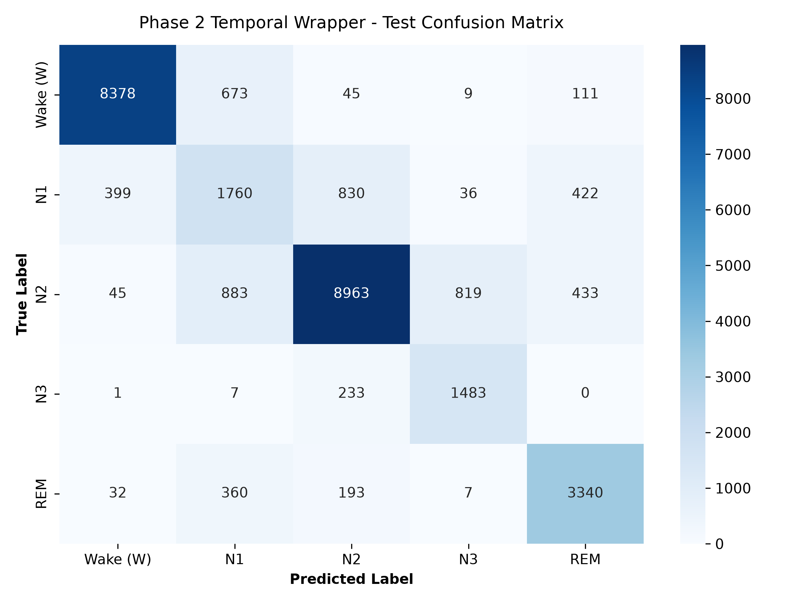

# Sleep Stage Classification with Hierarchical Transformers

A modular, production-grade deep learning pipeline for classifying 30-second EEG epochs into five distinct sleep stages (Wake, N1, N2, N3, REM) using a two-phase hierarchical architecture.

## Data Pipeline
* **Source Dataset:** PhysioNet Sleep-EDF (Sleep Cassette database).
* **Preprocessing:** Processed using MNE-Python to trim excessive daytime wake periods (retaining 30 minutes pre- and post-sleep). 
* **Storage:** Signals are saved as per-subject binary files accessed via a memory-mapped (`np.memmap`) custom PyTorch dataset class to prevent RAM overflow during local training.

## Architecture
* **Phase 1 (Single-Epoch Backbone):** A 1D Convolutional stem paired with a 4-layer Pre-LN Transformer encoder and a learnable `[CLS]` token to extract 128-dimensional representations per epoch.
* **Phase 2 (Temporal Sequence Wrapper):** A temporal transformer encoder operating over sliding windows of $L = 21$ contiguous epochs (10.5 minutes) over frozen Phase 1 features to capture inter-epoch transition rules and smooth out classification noise.

## Results (Unseen Test Subjects)

### Phase 1 Baseline (Single-Epoch)
* **Overall Accuracy:** `79.34%`
* **Macro F1-Score:** `0.7377`

### Phase 2 Hierarchical Pipeline (Temporal Wrapper)
* **Overall Accuracy:** `81.20%`
* **Macro F1-Score:** `0.7593`

### Phase 2 Per-Class Performance Breakdown
| Stage | Precision | Recall | F1-Score | Support |
| :--- | :---: | :---: | :---: | :---: |
| **Wake (W)** | 0.9461 | 0.9091 | **0.9272** | 9,216 |
| **N1** | 0.4779 | 0.5106 | **0.4937** | 3,447 |
| **N2** | 0.8732 | 0.8044 | **0.8374** | 11,143 |
| **N3** | 0.6300 | 0.8602 | **0.7273** | 1,724 |
| **REM** | 0.7757 | 0.8494 | **0.8109** | 3,932 |

